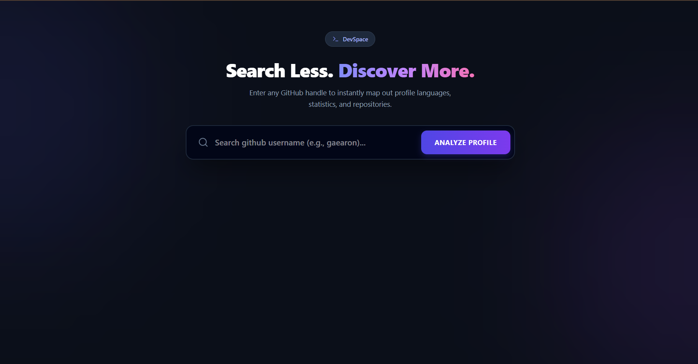
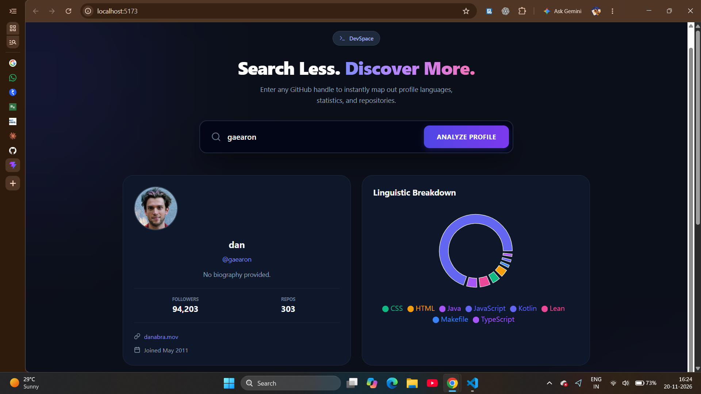
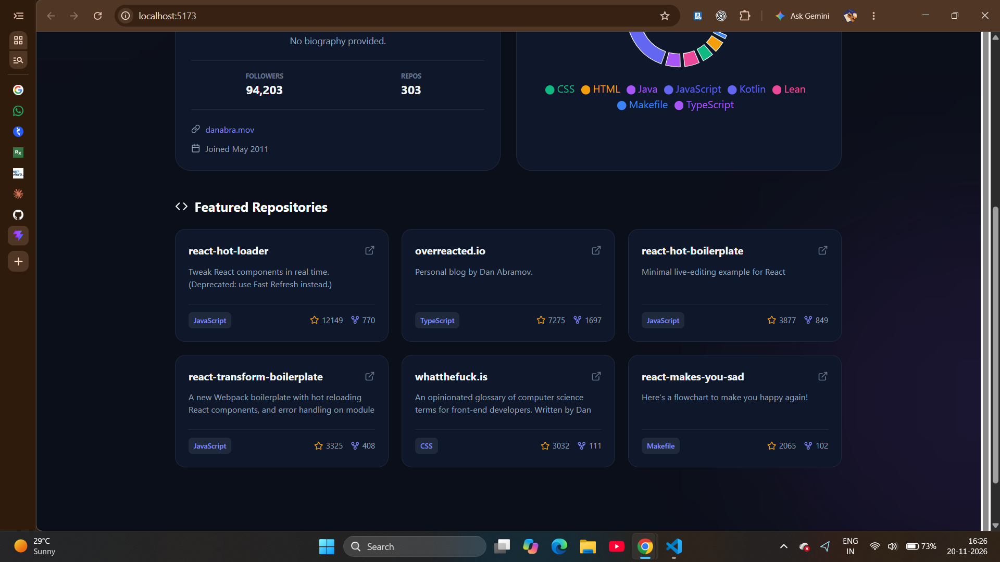
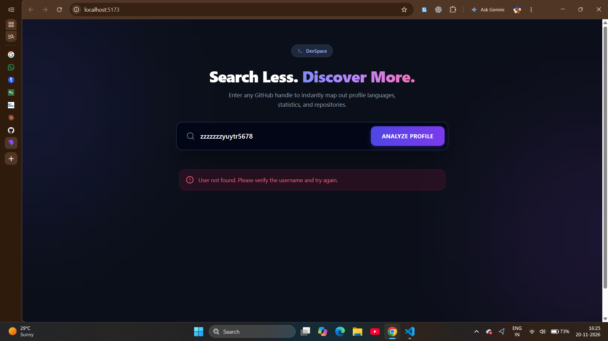

# DevSpace

A React app that takes a GitHub username and shows the developer's profile, a language breakdown chart, and their top repositories, using the public GitHub REST API.

**Live demo:** https://devspace-five.vercel.app/



## Features

- Search any GitHub username and see avatar, name, bio, followers, repo count, location, website and join date
- Donut chart showing how many of the user's own repositories use each language (forks are excluded)
- Top 6 repositories ranked by stars + forks (forks are excluded)
- Loading skeleton while data is fetched
- Clear error messages for: user not found (404), GitHub rate limit reached, and network failure
- Cancels the previous request when a new search starts, so an old response never overwrites a new one

## Screenshots

| Profile and chart | Repositories | Error state |
|---|---|---|
|  |  |  |

## Tech Stack

- React 19 with Vite
- Tailwind CSS v4 (page layout) and inline style objects (component styling)
- Recharts for the language chart
- Lucide React for icons
- GitHub REST API (no authentication)

## Project Structure

```
src/
  components/    SearchBar, ProfileCard, RepoList (UI only)
  hooks/         useGitHubProfile.js (loading, error and data state, request cancellation)
  services/      github.js (API calls, error handling for 404 and rate limits)
  utils/         repoStats.js (language counting and top-repo ranking, pure functions)
  App.jsx        Page layout, connects the hook to the components
```

## How It Works

1. `SearchBar` sends the username to `useGitHubProfile`.
2. The hook cancels any previous request with `AbortController`, then calls `fetchProfile`.
3. `fetchProfile` requests the user and the repos in parallel with `Promise.all`.
4. `repoStats.js` turns the repo list into chart data and the featured list.
5. `App.jsx` renders loading, error or result based on the hook's `status`.

## Run Locally

```bash
git clone https://github.com/Maniteja0407/devspace.git
cd devspace
npm install
npm run dev
```

## Known Limitations

- Only the first 100 repositories are analysed (one API page).
- The chart uses each repo's primary language, so it shows repo counts per language, not lines of code.
- GitHub allows 60 unauthenticated requests per hour, so heavy use will hit the rate limit.
- No automated tests yet.

## What I Learned

- Handling race conditions in async React code with `AbortController` and effect cleanup
- Separating API logic, data processing and UI using a custom hook, a service file and utility functions
- Reading GitHub rate-limit response headers to show a useful error message
- Debugging a Tailwind v4 setup that silently did nothing because the config was missing

## Possible Improvements

- Cache results for usernames already searched
- Search history and a compare-two-developers view
- Unit tests for `repoStats.js`
- Debounced search suggestions